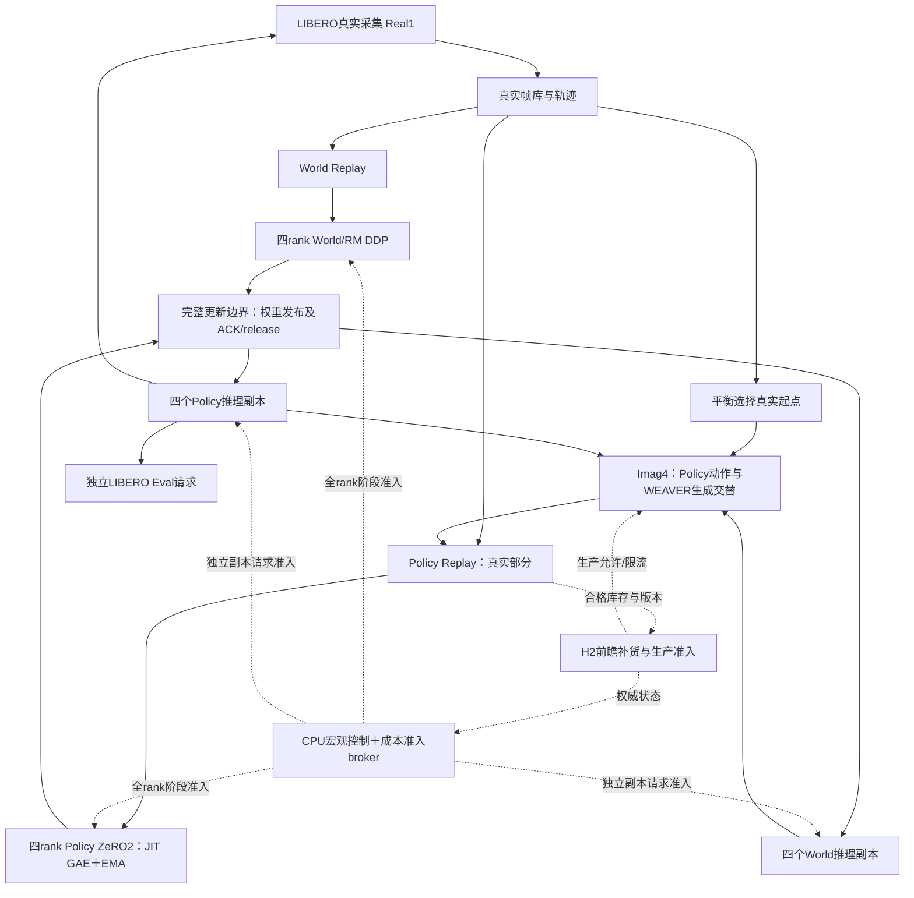

# 当前架构、串行原因与候选改进

分析基于2026-11-03运行的255文件完整轨迹版本，以及已归档的旧JIT P40/W8原始遥测。当前运行 `weaverintegrated_1103_145816_a9fe5a02` 保持冻结。本目录是独立候选，尚未部署；下文区分当前行为、已实现候选和待GPU验证项。

## 1. 实际部署是四卡、四类模型服务

10月8日的八卡方案是研究设想。当前实验实际使用GPU4–7，每张卡共置四个GPU模型实例，共16个：Policy trainer、Policy inference、World/RM trainer、World/RM inference。所有服务在固定四卡布局上运行，未动态改变模型并行规模。

| 角色 | 模型与通信 | 输入和产出 |
|---|---|---|
| Policy trainer | OpenVLA ActorCritic；四rank ZeRO2训练组 | global576，144真实/432想象；JIT GAE与全局Advantage EMA；更新Policy/Value |
| Policy inference | 四个独立模型副本，不组成一次联合前向 | 给真实采集、想象动作/bootstrap、Eval提供服务；旧刷新队列接口保留，JIT不使用它 |
| World/RM trainer | 原生WEAVER＋内置RM，四rank native DDP训练组 | 真实轨迹窗口global1024；每五次Policy更新一次；RM目标为折扣成功结果 |
| World/RM inference | 四个独立native模型副本 | 历史上下文和动作→未来状态/图像/评分；当前仍单请求生成 |

Value不是第五个独立GPU服务，Reward也不是本实验单独的第五个trainer。历史字段`ctrl`在这里代表WEAVER。native WEAVER采用独立Python环境/worker，bridge负责通信和生命周期；这些额外CPU进程不增加上述GPU模型角色数量。



CPU主控、Ray actor、LIBERO仿真、Replay/元数据、SQLite遥测、队列包装器不属于GPU训练服务。MPS支持共置，当前并不根据宏观权重在线修改MPS配额。

## 2. 一次更新的数据和控制过程

1. 主控读取Replay库存、World数据量和权威生产状态，向broker提交下一次更新的规划输入。
2. Policy选取144真实chunk及108条完整四-chunk想象轨迹；每rank36真实＋27条想象轨迹。版本/使用次数合格才可预留，只有optimizer成功才提交消费。
3. Policy trainer内按完整后缀依赖计算当前Value及detached GAE，所选状态复用训练前向。整个GAS窗口采用同一全局EMA，成功后更新供下一窗口使用。真实后缀仍可能有上下文补算；EMA不能消除轨迹bootstrap要求。
4. 普通轮只更新Policy。第五轮主控同时提交Policy四rank和World四rank的任务；两者各自进入四rank阶段门。
5. 主控等应完成的两类更新全部成功后才发布对应权重，核对内容hash、四rank ACK和引用释放；下一轮使用新发布版本。

代码入口：`train.py/main()`、`split_serial.py/epoch_groups()`、`fresh_policy_replay.py`、`trajectory_sampling.py`、`jit_gae_runtime.py`、`weaver_online_bridge.py`、`cost_scheduler_runtime.py`。

## 3. 为什么用户记得并行，但现在测得串行

这是三个不同层次：

- **主控提交并行**：`run.sh`设`ACCERL_SPLIT_TRAIN_SERIAL=0`，`epoch_groups()`返回一组全部owner，主控异步提交两个训练组。
- **调度准入串行**：原`cost_03_adaptive.json`的`training_gangs=1`，broker的`training_lane`容量1；两个训练组都申请所有四卡lane及该共享训练lane，只有一个组能获得完整optimizer更新许可。
- **GPU执行可重叠**：在上述限制下，获准trainer与推理仍可重叠；这不能证明Policy训练与World训练重叠。

较早无此单lane限制的版本确实可以让两个trainer并行。后来保守的整个optimizer更新门引入了额外串行。旧JIT P25/P30/P35/P40的实际准入事件均是World之后Policy；不是仅凭配置推断。JIT又把此前可与World更新重叠的共享critic刷新搬进Policy训练门，进一步增加联合轮关键路径。

旧P21–40：普通轮215.66→193.39秒，联合轮360.70→432.58秒，周期1223.38→1206.19秒，14.71→14.92 Policy/h。四轮普通阶段省约89秒，联合轮多约72秒。历史非随机对照与EMA目标差异使其不能当作纯因果测量。

## 4. 为什么adaptive实际没有调权

归档原始168个决策包含阶段建议；真正`update_cycle()`可改权重的决策只有40个：31个ready_services为空，8个仅World训练，1个生产服务。31个空集合中24个已有有限耗时预测。细节保存在`validation/parent_macro_diagnosis.json`，含原始文件SHA。

具体条件相互错开：

1. 允许改权重的时点是每轮取样前，`phase=needs_batch`。
2. JIT没有共享刷新债务，库存够用时应接着训练，但旧`ready_services()`只在`phase=train`才加入Policy训练。
3. World立即可训练时是已完成P4/P9等，而受控探索要求已完成P5/P10等完整周期边界。因此有World候选的时候不允许探测，允许探测时又没有Policy候选。
4. 另一个设计限制是完整预测依赖各服务响应率；只要某生产服务在窗口内被限流，该项响应就被剔除。用这种容量预测作为一切试探的前置条件，也可能永久阻断探索。停产属于系统的正常反馈，完整周期仍有可测量的耗时。

这不是MPS修改失效，也不是权重文件没载入，而是控制状态与可执行决策边界不一致。

## 5. 候选实现：完整周期反馈

`cycle_feedback.py`直接记录连续五次Policy和一次World成功发布边界间的完整墙钟时间。数据等待、发布、真实/想象生产限制均计入，既不相加重叠阶段，也不把未知响应拟合成线性GPU份额。

- 默认排除P1–20，收集两个连续基线周期后才试探；正常连续运行最早P30发生首次试探。
- 每次只在两个服务之间转移0.25权重，L1改变量0.5，总和4、每服务正下限保持。
- 修复`needs_batch`中零刷新且库存足够的Policy可执行性；按库存缺口选择生产或训练方向，World在下一完整周期内的需求也可作为候选。
- 更新真实scheduler账户，而非仅输出建议；新事件`cost_weights_applied`包含旧/新向量和版本。已提交工作仍按提交时权重结算。
- 保持候选两个完整周期，用实测周期均值、最小改善阈值、切换惩罚和库存保留检查决定接受/回退；波动过大不接受。若只是消耗库存换短期快更新，库存保留检查会拒绝。
- 超时后在无在途训练/未发布更新的边界回退；即使缺货导致下一轮长期未完成，权威库存回调也能触发检查。版本缺口、重复通知、部分周期和跨权重周期不计有效测量。
- 提供明确等待原因。试探失败记忆有界，避免反复探测同一向量对；生产准入和Replay的硬约束仍有最终决定权。

这是顺序在线试探，不是随机A/B，也不是最优资源分配证明。完整周期比较仍受真实任务时长与模型演化影响；两周期只是保守最小观察要求。数据记录包含逐周期时长、新入池数量、库存覆盖，方便事后审查。

## 6. 候选实现：两训练组并行准入

并行配置将`training_gangs`设为2，同时`card_inflight`由2增至3。每个训练组仍一次占一条每卡逻辑lane，所以两组同时执行时，每卡还留有一条推理提交容量。这些是准入计数，**不是SM占比或显存预留**。

两组必须为不同服务，绑定同一已发布Policy/World版本；各自四rank全部到齐、各自通信和流边界验证仍保留。发布期间拒绝新训练阶段。任一组失败阻止后续准入，已提交的另一组继续按原协议收尾，不撤销其collective。

`cost_training_execution_admitted`记录共同在途训练ID，可证明两个完整训练区间是否同时获准。它不能证明CUDA kernel实际同时执行，真实并行效果还须结合阶段耗时与必要时的GPU时间线。

没有引入任意microbatch抢占，没有改DDP/ZeRO2通信协议，没有动态更改MPS配置。两组并发的显存峰值、NCCL活性与互相干扰仍需单独GPU验收。不能把旧单组采样峰值98GiB当成两组并行的安全证明。

## 7. 消融与当前交付范围

| 配置 | 训练组上限 | 宏观反馈 |
|---|---:|---|
| `cycle_00_parent.json` | 1 | 原03_adaptive控制器；共享可执行性修正已生效，严格旧控制请用冻结父源码 |
| `cycle_00_fixed_serial.json` | 1 | 固定权重，宏观关闭；用于与以下三项构成2×2消融 |
| `cycle_01_feedback_serial.json` | 1 | 新完整周期反馈 |
| `cycle_02_parallel_fixed.json` | 2 | 固定权重，宏观关闭 |
| `cycle_03_feedback_parallel.json` | 2 | 新完整周期反馈 |

可独立检查宏观修复和并行准入；当前GPU run不受影响。本候选尚未启动GPU实验。

```text
python validate_cycle_parallel_candidate.py
```

未来独立实验的入口为`bash run_cycle_parallel.sh 03_feedback_parallel`，要求新`ACCERL_EXPERIMENT_ROOT`，不会提交队列或停止任何已有run。正式包装器也必须显式选择新cost profile，不能因默认仍指向旧03_adaptive而误以为启用了改动。

验证重点是实际broker权重应用、双训练组/推理共同进展、版本不一致共同失败、已授予组收尾、超时回退、库存耗尽防伪收益、完整周期与重复边界处理。CPU验证不证明GPU并行安全或端到端加速。

父版的JIT、EMA、轨迹抽样、损失、奖励、配额、版本年龄、成功使用上限、World训练实现及主训练循环均保留逐文件SHA。新模块在CPU边界做常数级统计，不新增逐micro GPU→CPU读回，不复制模型权重或Replay数据。它仍依赖现有Ray/CPU控制，不能称全GPU调度。
