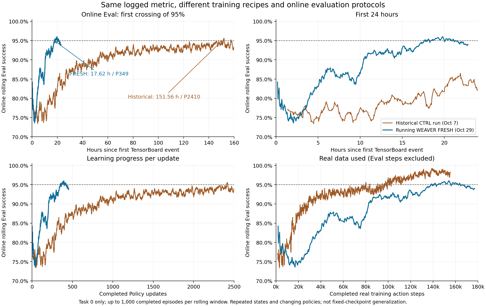

# Running WEAVER FRESH experiment — 2026-10-29

This archive preserves the **actual frozen source currently running** for
`weaverintegrated_1029_113256_f897f7dd`. It includes the FRESH learning changes,
existing execution optimizations, configuration, tests and small verification
records. The later cost-accounting scheduler is not deployed in this run.

| Identity | Value |
| --- | --- |
| Start | 2026-10-29 11:32:56 Asia/Shanghai |
| TensorBoard run | `1793244803_OpenVLA_IntegratedWEAVER_PolicyWorldRM_Real1_Imag4_Budget1M_Manual_gpu47_fresh` |
| Frozen files | 187, plus their original `source_manifest.json` |
| Source SHA256 | `2b21e8f707c2f5a02415ede5e73db3162bfc6b4e67ca4089717c2cc58df8d706` |
| Manifest SHA256 | `8fc7cad70ede2a08eb8615bd5faa106e43cac1569c5c9869cb9524a9fe4ba605` |
| Active profile | [`source/examples/fresh_04_real.json`](source/examples/fresh_04_real.json) |
| Base runtime commit | `a0a0dfa969a9f1a8f5e85af0bca0b5facab5b5d8` |

The source manifest was written before launch. Its `production_activated=false`
and `full_model_fresh_verified=false` fields describe that creation-time state.
They have deliberately not been edited. Later startup and actual first-update
verification are in [`evidence/`](evidence/).

## Observed training result

The online task-0 rolling Eval first reached 95% after **17.62 hours / 349 Policy
updates**, compared with **151.56 hours / 2,410 updates** for
`1791343661_OpenVLA_DS_gipo_DISCRETE_task0_ctrl_wm_same_param`.
This is an observed **8.60x time-to-first-threshold difference** between two runs,
not a controlled infrastructure speedup or a fixed-checkpoint benchmark.

At approximately 20 hours FRESH logged 95.1%. At the common export ending
2026-10-30 10:22:24 BJT / P454 it logged 94.0%; its last 100 logged Eval windows
averaged 94.986%, with a 93.7–96.0% range. The windows overlap and contain changing
policies. This is not evidence of a checkpoint that consistently scores 95%.

Read [`RESULTS.md`](RESULTS.md) for metric reconstruction, exact data budgets,
protocol differences, plausible mechanisms and causal limits. Raw training event
files, checkpoints, optimizer state, Replay, frames and databases are not included.

## Learning recipe

- Four FRESH changes enabled independently in code and together in this run:
  dense discounted real-success targets for the native reward head; ordered
  segment Replay and current-critic GAE; outcome/position-balanced imagination
  seeds including explicit early-context repetition; and 25% real / 75% imagined
  Policy samples with unexecuted action tails masked.
- Policy age at most 16, World/RM age at most 3, at most four successful uses.
  Original behavior logits remain the importance-ratio denominator. Old imagined
  rewards are not relabeled and old imagined states are not regenerated.
- New Policy/Value/optimizer/Replay; Policy initialized from pretrained assets,
  not resumed from the retired run. Native WEAVER initialized from an offline
  3,200-update bundle; this pretraining cost is outside the online clock.
- Four Policy ZeRO-2 ranks, global batch 576. Ordinary microbatch 8 / GAS18;
  every fifth Policy update uses microbatch 4 / GAS36. Policy warmup 100 updates.
- Four native World/RM DDP ranks, microbatch 4 / GAS64 / global batch 1024,
  one joint World/RM update per five Policy updates. One joint optimizer for
  921,834,497 trainable parameters / 403 tensors; no separate reward service.
- Real1 / Imag4 workers, task0, 50 benchmark initial states, seed20261026 for the
  global real-state schedule, 1M simulator-call budget including reset settling.
  Budget is bounded and the run has manual stopping with no time deadline.

Dense targets change the supervision objective. They do not mean the old binary
labels were inconsistent with instantaneous `is_success`. The native score is
uncalibrated; a score delta is not itself a proven potential-based reward scheme.
The repeated early-context tokens enter the model; no new attention padding mask
is implied.

## What is preserved and how to inspect it

- `source/`: byte-exact 187-file runtime overlay and original manifest.
- `base_overlay/`: the 16 Python differences present in the actual historical
  AcceRL runtime checkout. Some are historical entrypoints, not FRESH entrypoints.
- `host_support/`: the three historical CPU helper modules required by supervisor
  imports, stored separately to preserve the frozen source identity.
- `runtime_provenance.json`: base revision, exact support hashes, installed package
  metadata from both Python environments. Metadata inspection did not import torch.
- `evidence/`: startup/first-loop receipts and CPU validation records with their
  original scopes, plus exported scalar CSVs and this run comparison.
- `verify_snapshot.py`: CPU-only integrity, syntax and archive-boundary checks.

Run `python verify_snapshot.py` from this directory to verify the archive without
loading models or starting training. See [`REPRODUCTION.md`](REPRODUCTION.md) for
runtime dependencies and portability limits. This is an experiment archive with
external model/data assets, not a one-command standalone distribution.
